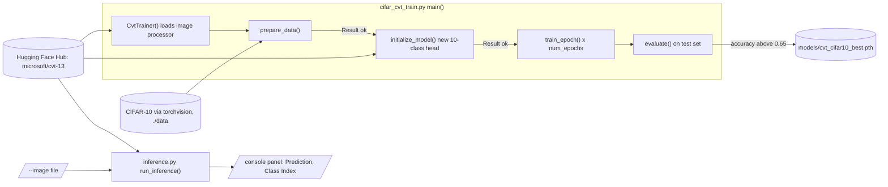

# cifar-cvt-13 - documentation hub

`cifar-cvt-13` holds two Python console scripts around the CvT-13 image
classifier (`microsoft/cvt-13`, loaded through Hugging Face Transformers) and the
CIFAR-10 dataset. `cifar_cvt_train.py` fine-tunes the pretrained model on
CIFAR-10, prints a classification report for the test set and saves the weights
when the test accuracy is above 65%. `inference.py` classifies one image file
with a Hugging Face checkpoint (`README.md:3-6`, `pyproject.toml:17`). The
repository does not name its users. Commit `3dfb47e` ("remove the course brief -
it is the course's text, not this project's") removed `docs/task.md`, which its
message calls a paid course's lesson; the brief asked for this fine-tune and said
a correct solution exceeds 65% test accuracy after one epoch, so the scripts began
as a course assignment.

The requirements specification reverse-engineered from the code is
[`SPEC.md`](../SPEC.md).

## 1. Status

| Item | State | Source |
| --- | --- | --- |
| Documented commit | `a8b0dd1`, 2026-11-08, merge of PR #19 "bring cifar-cvt-13 to revision 4.0.0"; tag `v1.0.0` points at it | `git log`, `git tag` |
| Last change of the project's own code | scripts: `fcc46b4`, 2026-11-08 03:46:57 +0200; test files `tests/*.py`: `4464083`, 2026-11-08 03:47:04 +0200 (`tests/manual/` last in `0786476`, 03:48:10) | `git log -- cifar_cvt_train.py inference.py tests` |
| History | 31 commits, the first (`07844a3`) dated 2026-04-22 | `git log` |
| Version | `1.0.0` | `pyproject.toml:16`, `recipe.ps1:13` |
| Automated tests | 22 pytest functions in 4 files: 14 for training, 5 for inference, 2 for the manual test list, 1 offline guard. Counted from `def test_` lines, not executed here | `tests/` |
| Manual tests | `tests/manual/tests.json` has an empty `tests` list | `tests/manual/tests.json` |
| CI | Five Gitea Actions workflows in `.gitea/workflows/`. There is no `.github/` directory, so the GitHub copy runs no workflow. Whether a Gitea runner serves this repository is not stated | `.gitea/workflows/`, `CLAUDE.md` |
| Open items named by the author | Lab-requirement exceptions R-02, R-09, R-41, R-42 (issues #8-#11) | `README.md:25` |
| Evidently unfinished | The validation split is never evaluated; the `.pth` the trainer saves cannot be loaded by `inference.py` | `docs/manual.md:23`, `docs/manual.md:33` |

## 2. Layout

| Path | What it is |
| --- | --- |
| `cifar_cvt_train.py` | Training script: `Result`, `ModelConfig`, `CvtTrainer`, `main()` |
| `inference.py` | Single-image classification: `run_inference()`, `main()` with `argparse` |
| `tests/test_cifar_cvt_train.py` | Tests of `Result`, `ModelConfig`, every `CvtTrainer` method and `main()` |
| `tests/test_inference.py` | Tests of label resolution and the command line of `inference.py` |
| `tests/fake_cvt_model_and_cifar10.py` | Stand-ins for the processor, the model and CIFAR-10, so no test downloads anything |
| `tests/conftest.py` | Sets `HF_HUB_OFFLINE=1` before any test imports `huggingface_hub` |
| `tests/test_no_weights_are_downloaded.py` | Asserts that the Hub is offline for the whole run |
| `docs/install.md`, `docs/manual.md` | Author's install notes and the description of what each script prints |
| `docs/index.html`, `docs/cifar_cvt_train.html`, `docs/search.js` | pdoc 16.0.0 API page of `cifar_cvt_train` (redirect, page, search index) |
| `docs/assets/sample_airplane.png` | Sample image used in the README's inference command |
| `scratch/` | Three ad-hoc scripts: processor check, model load check, generator of `workflow_prompts/` |
| `workflow_prompts/` | 25 one-paragraph prompt files (requirements, ADR, C4, Docker/CI, ...) |
| `pyproject.toml`, `uv.lock` | Pinned dependencies and the settings of pytest, coverage, mypy and ruff |
| `.vscode/` | Editor settings, tasks and launch configurations, mostly for CMake/C++ |

## 3. Architecture

Both scripts are single modules with no shared code. `cifar_cvt_train.py` keeps
the steps in `CvtTrainer` and the order of steps in `main()`; data and model
loading return a `Result` instead of raising (`cifar_cvt_train.py:23-44`,
`:86-131`). The image processor and the model come from the Hugging Face Hub
through `from_pretrained` (`cifar_cvt_train.py:78`, `:126`, `inference.py:26-27`);
CIFAR-10 comes through `torchvision.datasets.CIFAR10(download=True)`
(`cifar_cvt_train.py:92-97`). Both pick CUDA when available, otherwise the CPU
(`cifar_cvt_train.py:77`, `inference.py:22`).

## 4. Build and run

Prerequisites: uv and Python 3.13 (`docs/install.md:3`; `pyproject.toml:21`
allows `>=3.13,<3.14`; `uv.lock:3` locks `==3.13.*`). `recipe.ps1` needs
PowerShell. The first run needs a network connection: CIFAR-10 (about 170 MB)
goes into `data/` and the CvT-13 weights into the Hugging Face cache
(`docs/install.md:8`).

| Step | Command | Source |
| --- | --- | --- |
| Install the locked environment | `uv sync --frozen` | `docs/install.md:4` |
| Fine-tune and evaluate | `.\recipe.ps1 run` (runs `uv run --frozen python cifar_cvt_train.py`) | `README.md:13`, `recipe.ps1:60-65` |
| Classify one image | `.\recipe.ps1 run inference.py --image docs\assets\sample_airplane.png` | `README.md:14` |
| Build the wheel into `dist\` | `.\recipe.ps1 build` | `recipe.ps1:48-51`, `docs/install.md:10` |

Run both scripts from the repository root: `data/` and `models/` are relative
paths (`docs/manual.md:13`).

## 5. Configuration

The training script has no command-line options and reads no environment
variable; its settings are the defaults of `ModelConfig`, changed by editing the
code (`cifar_cvt_train.py:48-57`, `docs/manual.md:17`).

| `ModelConfig` field | Meaning | Default |
| --- | --- | --- |
| `model_name` | Hugging Face checkpoint for processor and model | `microsoft/cvt-13` |
| `data_dir` | CIFAR-10 download and cache directory | `./data` |
| `batch_size` | Batch size of all three loaders | `64` |
| `num_epochs` | Training epochs | `1` |
| `val_size` | Images held out of the training set | `5000` |
| `lr` | AdamW learning rate | `5e-5` |

Fixed in code: save threshold `0.65` and path `models/cvt_cifar10_best.pth`
(`cifar_cvt_train.py:220-224`).

| `inference.py` flag | Meaning | Default |
| --- | --- | --- |
| `--image` | Path of the image to classify (required) | none |
| `--model` | Hugging Face checkpoint name or folder | `microsoft/cvt-13` |

Source: `inference.py:83-85`, `docs/manual.md:33`.

| Variable / file | Used by | Meaning |
| --- | --- | --- |
| `HF_HUB_OFFLINE` | `tests/conftest.py:6` | Set to `1` for the test run |
| `LAB_SHARE` | `recipe.ps1:68` | Target folder of `recipe.ps1 publish`; the verb fails without it |
| `.claude/.env` | `recipe.ps1:35-43` | Optional `NAME=value` lines loaded into the environment; gitignored. The scripts need no key |

## 6. Usage

- Fine-tune: `.\recipe.ps1 run`. The script logs the device, the
  train/validation/test sizes, the model architecture, a progress bar with the
  current loss, the average loss per epoch, the classification report and
  `Final Accuracy: <value>`, then saves or warns (`docs/manual.md:19-21`).
- Classify with the default checkpoint:
  `.\recipe.ps1 run inference.py --image <path>`. `microsoft/cvt-13` is an
  ImageNet-1k model, so the label is an ImageNet class (`inference.py:55-59`,
  `docs/manual.md:31`).
- Classify with another checkpoint: add `--model <name or folder>`. A ten-class
  checkpoint whose labels are `LABEL_0`...`LABEL_9` gets the CIFAR-10 names; an
  index without a label is printed as the number (`inference.py:60-67`).
- Show the project's identity: `.\recipe.ps1 info` (`recipe.ps1:76-83`).

## 7. Testing

`.\recipe.ps1 test` checks that `recipe.ps1` and `pyproject.toml` name the same
version, sets `core.hooksPath`, then runs pytest, mypy, `ruff check` and
`ruff format` (in place), stopping at the first failure (`recipe.ps1:84-111`).
pytest runs with branch coverage and fails below 97% (`pyproject.toml:80`,
`:85`); mypy is strict over both scripts and `tools` (`pyproject.toml:93-94`).

The tests replace the processor, the model and CIFAR-10 with the fakes in
`tests/fake_cvt_model_and_cifar10.py`, and `HF_HUB_OFFLINE=1` makes any real
download fail (`tests/conftest.py:6`). Covered: `Result`, the `ModelConfig`
defaults, the transform, the data split and its failure, the head replacement and
its failure, one training epoch, accuracy, the save/no-save branches of `main()`,
both early stops, label resolution in `inference.py` and its required `--image`.
Not covered by any test: a failure while loading the image processor, the real
model and data, the CUDA path, a missing image file.

## 8. Known limitations and problems

1. The validation loader is built and discarded (`_val_loader`,
   `cifar_cvt_train.py:194`); nothing is evaluated on it (`docs/manual.md:23`).
   The save decision uses the test-set accuracy (`cifar_cvt_train.py:216-220`).
2. `random_split` gets no seeded generator (`cifar_cvt_train.py:100-102`), so the
   split differs between runs.
3. The AdamW optimizer is created inside `train_epoch` (`cifar_cvt_train.py:136`).
   Inference from the code: with `num_epochs > 1` its state would restart every
   epoch. The default is one epoch.
4. The image processor is loaded in `CvtTrainer.__init__`
   (`cifar_cvt_train.py:78`), outside the `Result` handling: a failure there raises.
5. `main()` returns normally after a reported data or model failure, so the exit
   code is 0 in those cases too (`docs/manual.md:21`); only an exception such as
   item 4's ends it non-zero.
6. `inference.py` cannot load `models/cvt_cifar10_best.pth`: the file holds only a
   `state_dict` (`docs/manual.md:33`). It has no error handling around
   `Image.open` (`inference.py:32`).
7. On Windows the locked `torch` is the CPU build (`pyproject.toml:23-25`,
   `docs/install.md:6`). Training time on the CPU is not stated anywhere.
8. `docs/install.md:8` says `data/` and `models/` are gitignored, but `.gitignore`
   at `a8b0dd1` lists neither (`git check-ignore` matches nothing). Both, with
   `*.pth`, were ignored until `ead7824` (2026-11-08) replaced `.gitignore`.
9. The pdoc page `docs/cifar_cvt_train.html` was last changed in `07844a3`
   (2026-04-22); the scripts changed after that, and the page does not cover
   `inference.py`.
10. The comment in `tests/conftest.py:3-5` mentions "SigLIP 2 weights", a
    different model; the setting itself is project-neutral.
11. The lab-requirements link in `README.md:25` points at a loopback address
    (`127.0.0.1:3000`), which does not resolve for readers of the GitHub copy.
12. `.vscode/` carries CMake, clangd and LLDB configuration; the project has no
    C/C++ code (`.vscode/tasks.json`, `.vscode/launch.json`).

## 9. Repository tooling

The project follows
[repo-quality-template](https://github.com/IGORSVOLOHOVS/repo-quality-template),
lab requirements revision 4.0.0, with the exceptions R-02, R-09, R-41, R-42
(`README.md:25`). Specific here:

- `recipe.ps1` variables: `$Name = 'cifar-cvt-13'`, `$Code = 'cc1'`,
  `$Version = '1.0.0'`, `$Provides = @('cifar_cvt_train.py', 'inference.py')`,
  no `$App` (taken as a library, no installer), empty `$Needs` and `$Tools`,
  commit scopes `core`, `build`, `ci`, `docs`, `deps` (`recipe.ps1:11-24`).
- Verbs that act: `run` (default script `cifar_cvt_train.py`), `build`, `test`,
  `info`, `clean`, `publish` (needs `LAB_SHARE`). `install` and `uninstall` only
  print "nothing to install/uninstall" (`recipe.ps1:47-111`).
- Deviation: `.claude/.env` is gitignored and never committed, reversing R-02
  (`CLAUDE.md` rule 4, `.gitignore`).
- The hooks, `.claude/settings.json`, `.claude/skills/`, `.gitea/`,
  `tests/manual/` and `tools/wiki.py` are byte-identical, as committed, to the
  template's `release` branch; only the `.ps1` hooks differ on disk, checked out
  with CRLF as `.gitattributes` asks.
  `.vscode/`, `scratch/` and `workflow_prompts/` are not from the template.

## 10. Related documents

- [`../README.md`](../README.md) - project overview
- [`../SPEC.md`](../SPEC.md) - requirements specification
- [`install.md`](install.md) - what to install
- [`manual.md`](manual.md) - what each script does and prints
- [`index.html`](index.html) - pdoc API page of `cifar_cvt_train`
- [`../CLAUDE.md`](../CLAUDE.md) - repository rules
- [`../CONTRIBUTING.md`](../CONTRIBUTING.md) - contribution steps
- [`../LICENSE`](../LICENSE) - MIT licence

## 11. About this document

Written 2026-11-18 from commit `a8b0dd1`. Checked with: `git ls-files`,
`git log`, `git tag`, `git check-ignore -v data/... models/...`, a
`diff --strip-trailing-cr` of the tooling files against the template's
`origin/release`, `grep` counts of `def test_`, and a module lookup in the system
Python. Not run: `recipe.ps1 test`, `run` or `build`, `uv sync`, pytest
(the system Python lacks torch, transformers, scikit-learn and pytest-cov, and
there is no `.venv`), and neither script. No network access was used.
